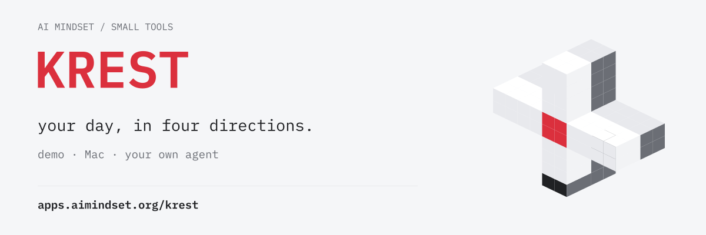
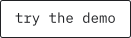
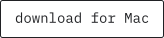
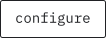
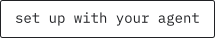
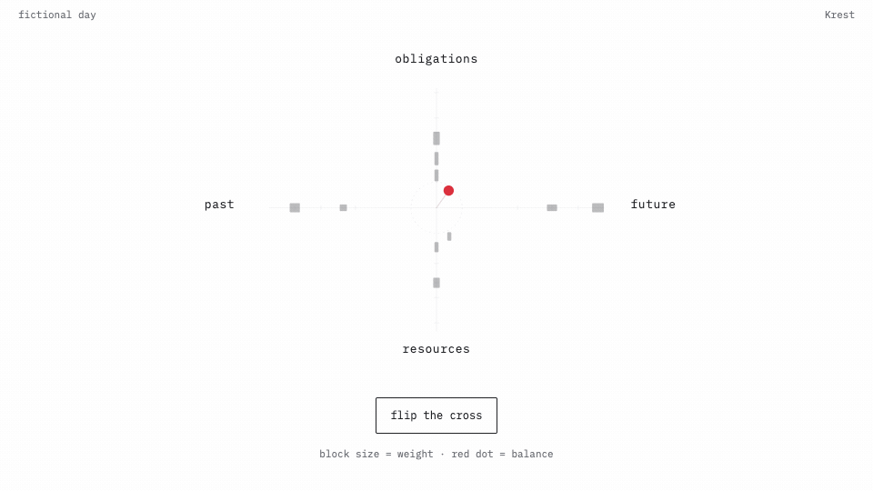

<picture>
  
</picture>

**See obligations, resources, past and future in one field.** Try a fictional day, choose your weights and build a private cross on your own data.

[](https://apps.aimindset.org/krest/demo.html?utm_source=github&utm_medium=readme&utm_campaign=krest#research) [](https://apps.aimindset.org/krest/?utm_source=github&utm_medium=readme&utm_campaign=krest#mac) [](https://apps.aimindset.org/krest/build.html?utm_source=github&utm_medium=readme&utm_campaign=krest#configure) [](https://apps.aimindset.org/krest/?utm_source=github&utm_medium=readme&utm_campaign=krest#install)



## Make it yours in 5 steps

1. **Copy the prompt to Claude Code or Codex.** Your agent gets the setup guide.
2. **Start a fictional day.** Your agent opens a working cross on your computer.
3. **Choose the weights.** [Configure](https://apps.aimindset.org/krest/build.html?utm_source=github&utm_medium=readme&utm_campaign=krest#configure), watch the dot move and download `правила.json`.
4. **Connect one source.** Your own calendar or manual notes appear with a source receipt.
5. **Add the Mac app, if you like.** Keep a compact view in your menu bar.

The guide comes from [AGENTS.md](AGENTS.md) in this repository. The [agent skill](skills/krest/SKILL.md) follows the same five steps.

### Copy the setup prompt

```text
Set up Krest on this computer from https://github.com/ai-mindset-org/toxic-cross. Read AGENTS.md and skills/krest/SKILL.md. Follow the five steps: copy this brief, start the fictional day on loopback, help me choose and apply правила.json at https://apps.aimindset.org/krest/build.html#configure, connect one source I choose, and optionally add the Mac app. Ask before installing an app, sending a bot message or enabling a schedule. Show me the working cross and a short verification receipt.
```

<details>
<summary>Run the fictional day yourself</summary>

```sh
git clone https://github.com/ai-mindset-org/toxic-cross.git
cd toxic-cross
python3 собрать.py
KREST_PORT=8777 python3 server.py
```

Open http://127.0.0.1:8777/ and choose Cross. Python 3.10+; no account. The server stays on loopback. Preserve personal sources in ignored local files. [Source contract](docs/свой-источник.md) · [operating templates](docs/OPERATIONS.md).

</details>

The [live walkthrough](https://apps.aimindset.org/krest/?utm_source=github&utm_medium=readme&utm_campaign=krest#live) includes block calculations, single-arm recoil, a four-arm flip and time windows. The Mac app includes a fictional day without setup when calendar access is unavailable; calendar mode reads this Mac locally. Set a private board URL in Settings when wanted.

## How to read it

**Up:** obligations. **Down:** resources. **Left:** past experience. **Right:** possible futures.

The original post connects **Beck’s cognitive triad**, **Lazarus’s demands/resources appraisal** and **Hobfoll’s loss spiral**. In the guided demo, a single-arm flip returns 75% of the removed weight over 26 seconds; flipping all four holds. This is an illustrative weight rule.

A block's distance shows time, its size shows declared weight. The red dot shows the balance of those weights. Flip offers a temporary perspective preview; source records remain intact. Weights and the four-arm construct are experimental choices, with no psychological calibration. A calendar event ending does not establish completion or how it felt.

The Mac companion adds optional feeling/energy check-ins and aggregate history. Check-ins form a separate journal and do not change source weights. Calendar sharing and ratings sync are separate controls. [Method](docs/METHOD.md) · [data flow](docs/DATA-FLOW.md).

## Your data and your copy

The demo is fictional. Your own board, calendar titles, tasks, notes and histories stay private. Read-only source adapters and explicit rules make the calculation inspectable. Keep the server on loopback; remote use requires your own authenticated private access and TLS. [Security](SECURITY.md) · [public boundary](docs/PUBLIC-BOUNDARY.md).

Mac 3.1.0 build 13 is an Apple silicon/macOS 13+ developer preview, ad-hoc signed and not notarized. Gatekeeper may block a download. Updates are manual. [Release and SHA-256](https://github.com/ai-mindset-org/toxic-cross/releases/tag/v3.1.0) · [native source and installation](native/README.md).

Code: [MIT](LICENSE). Fonts: [SIL OFL](ASSET-LICENSES.md). [Changelog](CHANGELOG.md) · [package and landing pattern](docs/PACKAGE.md) · [reusable README template](docs/README-TEMPLATE.md).

## Origin

The “toxic cross” model is [Vsevolod (Seva) Ustinov’s](https://t.me/vsevolodustinovchannel) idea, drawn on a napkin during a conversation on **15 September 2026**. The [18 September post](https://t.me/ai_mind_set/375) promised the code at 50 likes and received 106. Three versions and six weeks of trials on live data led to the open package on **27 October 2026**. Krest is an attempt to test the model hands-on. [Method and limits](docs/METHOD.md).

Made inside [AI Mindset labs](https://aimindset.org/?utm_source=github&utm_medium=readme&utm_campaign=krest#learning).
